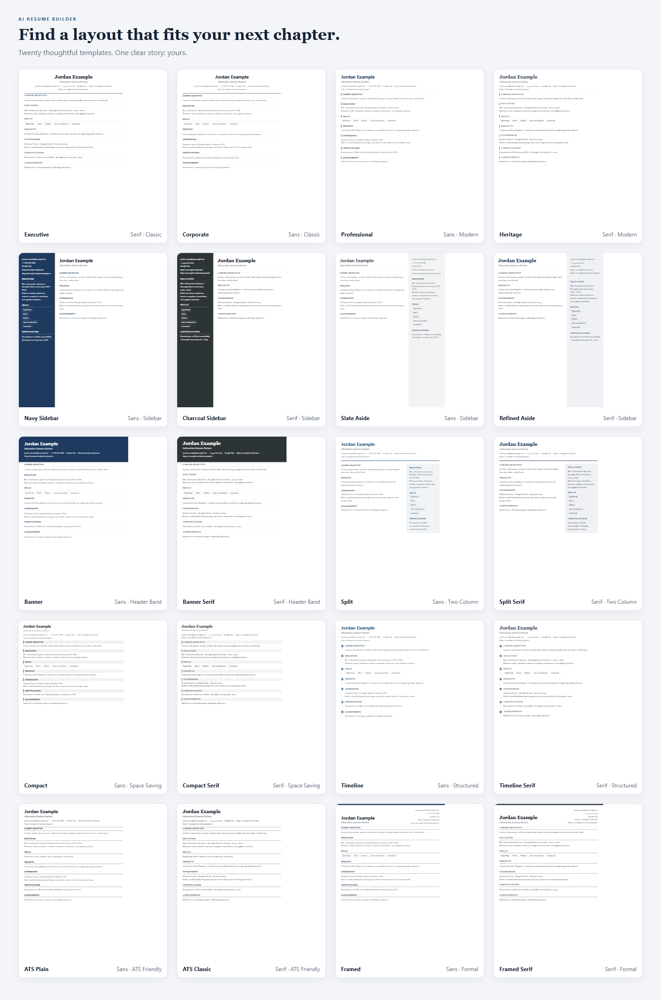
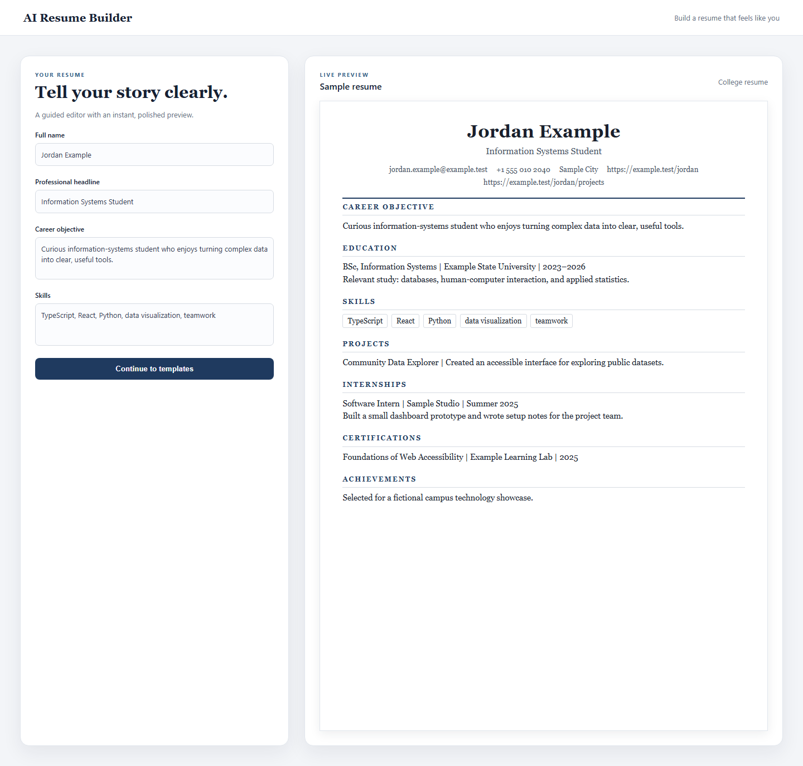
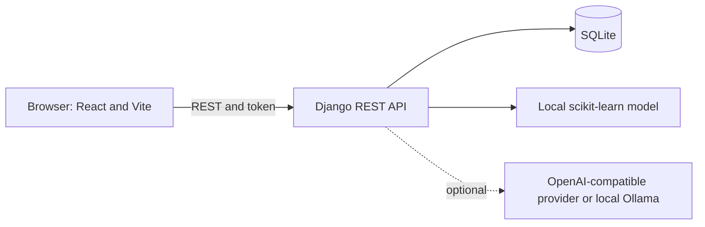

# AI Resume Builder

[](https://github.com/ansarismt/AI-Resume-Builder/actions/workflows/ci.yml)
[](https://www.python.org/)
[](https://nodejs.org/)

Create a polished, editable resume with a guided React editor, private saved versions, 20 templates,
and optional local analysis and AI writing tools.





## Features

- Light and dark themes, plus an interactive landing page with an arrow-field hero, a live
  AI-tool playground, a model preview and a career "slingshot".
- Guided resume editor and live preview for school, college, and professional resumes.
- 20 professional templates, saved resumes, and version history.
- Vector, selectable-text PDF through the browser print dialog; editable DOCX, JSON, and TXT
  downloads.
- PDF and DOCX import with AI-assisted field extraction.
- Dataset-powered AI Studio for resume-strength feedback, role matches, skills, and job-description
  comparison.
- Optional provider-backed writing tools, including summaries, bullet rewrites, tailoring, and
  cover letters.

## Architecture



See [docs/ARCHITECTURE.md](docs/ARCHITECTURE.md) for boundaries and data flow.

## Requirements

- Python 3.11 or newer.
- Node.js 20.19+ and npm (Vite 7 requirement).
- Windows, macOS, or Linux.

## Quick start

### Windows

```powershell
git clone https://github.com/ansarismt/AI-Resume-Builder.git AI-Resume-Builder
cd AI-Resume-Builder
.\start-dev.bat
```

The launcher creates `.env` from `.env.example` only when needed, creates the virtual environment,
installs dependencies when their lock files change, migrates the local database, then opens the
backend and frontend in separate terminal windows. Review `.env`; keep the example secret only for
local development. Open <http://127.0.0.1:8080>.

### macOS and Linux

```bash
git clone https://github.com/ansarismt/AI-Resume-Builder.git AI-Resume-Builder
cd AI-Resume-Builder
chmod +x scripts/dev.sh && ./scripts/dev.sh
```

The script performs the same setup, then runs Django and Vite in the current terminal. Press
Ctrl+C to stop both servers.

### Manual two-terminal setup

If you prefer separate shells, create a virtual environment and install dependencies first:

```powershell
python -m venv .venv
.\.venv\Scripts\python.exe -m pip install -r requirements.txt
if (!(Test-Path .env)) { Copy-Item .env.example .env }
npm ci
.\.venv\Scripts\python.exe manage.py migrate
```

Run `.\.venv\Scripts\python.exe manage.py runserver 127.0.0.1:8000` in one terminal and
`npm run dev` in another. On macOS/Linux, activate `.venv`, use `python` instead, and run
`cp .env.example .env`.

## Configuration

Copy `.env.example` to `.env` for local development. Blank LLM values disable provider-backed
writing tools; the local dataset model works independently.

| Variable | Default | Purpose |
| --- | --- | --- |
| `DJANGO_SECRET_KEY` | `generate-a-random-secret-key` | Django signing key; replace with a unique secret for deployment. |
| `DJANGO_DEBUG` | `True` in example; `False` in code | Local debug mode; must be false in deployment. |
| `DJANGO_ALLOWED_HOSTS` | `localhost,127.0.0.1` | Comma-separated Django hosts. |
| `DJANGO_DB_NAME` | `db.sqlite3` in example | SQLite database path. |
| `CORS_ALLOWED_ORIGINS` | `http://127.0.0.1:8080,http://localhost:8080` | Browser origins allowed to call the API. |
| `TOKEN_TTL_DAYS` | `14` | Authentication token lifetime in days. |
| `LLM_PROVIDER` | blank | `openai`, `openai-compatible`, or the supported local provider. |
| `LLM_API_KEY` | blank | Provider credential; backend only. |
| `LLM_MODEL` | blank | Provider model name. |
| `LLM_BASE_URL` | blank | Optional base URL for compatible providers. |
| `LLM_TEMPERATURE` | provider default | Optional generation temperature. |
| `LLM_MAX_TOKENS` | `2048` | Maximum provider output tokens. |
| `VITE_API_URL` | `http://127.0.0.1:8000/api` | Frontend API base URL. |
| `SECURE_SSL_REDIRECT` | enabled when debug is false | Force HTTPS in production. |
| `SECURE_HSTS_SECONDS` | `31536000` in production | HTTP Strict Transport Security lifetime. |
| `SECURE_HSTS_INCLUDE_SUBDOMAINS` | enabled in production | Include subdomains in HSTS. |
| `SESSION_COOKIE_SECURE` | enabled in production | Send session cookies only over HTTPS. |
| `CSRF_COOKIE_SECURE` | enabled in production | Send CSRF cookies only over HTTPS. |
| `SECURE_CONTENT_TYPE_NOSNIFF` | `True` | Add the content-type nosniff protection. |
| `X_FRAME_OPTIONS` | `DENY` | Prevent framing by other sites. |

Production security settings are overridable for deployment-specific infrastructure. Use a valid
HTTPS origin and never commit `.env`.

## AI features and privacy

| Feature | System | API key |
| --- | --- | --- |
| Resume strength and career-category matches | Local scikit-learn model | No, if trained artifacts exist. |
| Job-description comparison | Local scikit-learn model | No, if trained artifacts exist. |
| Skills suggestions | Local dataset statistics, with provider fallback | Usually no. |
| Resume import/parsing and writing suggestions | Configured generative provider | Yes. |
| Tailoring, cover letters, grammar, interview questions, LinkedIn headline | Configured generative provider | Yes. |

Dataset analysis runs on the Django backend. When a generative tool is used, the submitted content
is sent by the backend to the configured provider. Review its privacy and retention terms. AI output
may be inaccurate; verify every claim and never accept invented qualifications. See
[docs/AI.md](docs/AI.md) and [SECURITY.md](SECURITY.md).

Training is optional. Put an appropriately licensed CSV with `Resume_str` and `Category` columns at
`data/Resume.csv`, then run:

```powershell
.\.venv\Scripts\python.exe manage.py train_model
```

Training data and generated files under `ai/ml/artifacts/` are local and gitignored.

## Templates

| Template | Layout | Font |
| --- | --- | --- |
| Executive | Classic | Serif |
| Corporate | Classic | Sans |
| Professional | Modern | Sans |
| Heritage | Modern | Serif |
| Navy Sidebar | Sidebar | Sans |
| Charcoal Sidebar | Sidebar | Serif |
| Slate Aside | Sidebar | Sans |
| Refined Aside | Sidebar | Serif |
| Banner | Header band | Sans |
| Banner Serif | Header band | Serif |
| Split | Two column | Sans |
| Split Serif | Two column | Serif |
| Compact | Space saving | Sans |
| Compact Serif | Space saving | Serif |
| Timeline | Structured | Sans |
| Timeline Serif | Structured | Serif |
| ATS Plain | ATS friendly | Sans |
| ATS Classic | ATS friendly | Serif |
| Framed | Formal | Sans |
| Framed Serif | Formal | Serif |

Templates use the restrained palette in `shared/templates.json`. To add a template, update that
catalog; add layout CSS only when introducing a new layout.

## Exports

- **PDF:** use the browser print dialog and choose **Save as PDF**. This creates a vector,
  selectable-text PDF from the preview.
- **DOCX:** editable Word document that follows the selected template layout and colour, like the preview.
- **JSON and TXT:** server-generated formats for portability and plain-text use.

## Project structure

```text
backend/              Django settings, security, and routes
resumes/              Accounts, resume data, versions, and exports
ai/                   AI endpoints, local ML, and provider integration
shared/               Shared template and category catalogs
src/                  React routes, editor, templates, and API client
docs/                 Architecture, API, AI, and screenshots
samples/              Fictional sample resume
scripts/              Cross-platform development and screenshot scripts
.github/              CI, Dependabot, and contribution templates
```

## Testing and CI

```powershell
npm run check
$env:DJANGO_DEBUG = "True"
$env:DJANGO_SECRET_KEY = "local-test-key"
$env:DJANGO_DB_NAME = "$env:TEMP\resume-builder-tests.sqlite3"
.\.venv\Scripts\python.exe -m pip install -r requirements-dev.txt
.\.venv\Scripts\python.exe manage.py check
.\.venv\Scripts\python.exe manage.py makemigrations --check --dry-run
.\.venv\Scripts\python.exe manage.py test resumes ai
.\.venv\Scripts\python.exe -m ruff check .
```

GitHub Actions runs the frontend checks and backend checks on Python 3.11 and 3.12. More API
details are in [docs/API.md](docs/API.md).

## Troubleshooting

- **The page is blank or Vite does not respond:** check the terminal for errors; the watcher
  excludes `.venv/`, `data/`, model artifacts, build output, and generated router files.
- **“AI not configured”:** configure the backend provider, key, and model, then restart Django.
- **Local model unavailable:** add the training CSV and run `train_model`; otherwise local
  analysis features will report that the model is unavailable.
- **Saved-resume session error:** sign in again and confirm that the Django API is running.
- **Print preview shows two pages:** select A4 paper, disable browser headers/footers, and use
  the print preview to confirm page breaks before saving.
- **Port 8000 or 8080 is occupied:** stop the process already using it or adjust local server
  configuration.

## Contributing

See [CONTRIBUTING.md](CONTRIBUTING.md) for tests and pull-request guidance. Report vulnerabilities
privately as described in [SECURITY.md](SECURITY.md).

## License

Copyright (c) 2026 VDart.
