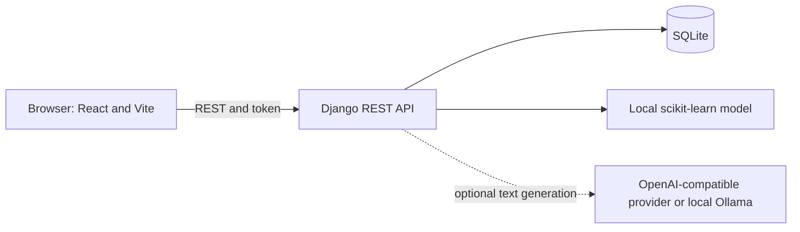

# Architecture

## Components

- `src/` contains the React, TypeScript, and Vite single-page application. The typed Axios client in `src/lib/resumeApi.ts` calls the API.
- `backend/` configures Django, security, database, and URL routing.
- `resumes/` owns accounts, resume data, versions, shared template metadata, and document exports.
- `ai/` exposes resume analysis, import, provider-backed writing tools, and the optional local model.
- `shared/templates.json` and `shared/categories.json` are the shared sources of truth for template and category metadata.
- `samples/sample_resume.json` is fictional and intended only for examples and visual checks.

## Data flow and boundaries

Resume records are private to the authenticated account. The frontend stores the token in browser
`localStorage` and sends it in the `Authorization: Token ...` header. The API validates ownership
for resume operations. Dataset-backed analysis runs in the Django process; it does not require an
external provider. A generative-AI request sends only the selected content to the backend-configured
provider. Provider credentials remain server-side.

Local development uses SQLite. Set `DJANGO_DB_NAME` to a persistent database path for the local
instance; tests and CI should use an isolated temporary database. The trained model and dataset
remain in ignored local paths (`ai/ml/artifacts/` and `data/`).

## Exports

The browser print flow produces the primary PDF from the exact resume preview. The server produces
editable simplified DOCX, JSON, and TXT files; its PDF endpoint remains for API and cover-letter
use cases and reports unsupported scripts rather than rendering broken glyphs.
